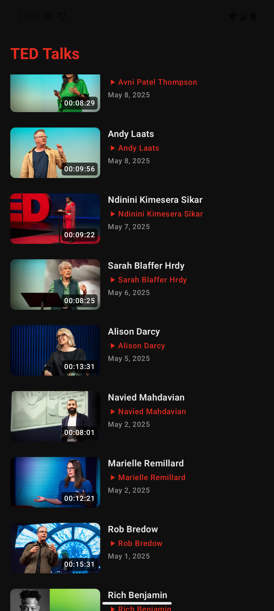
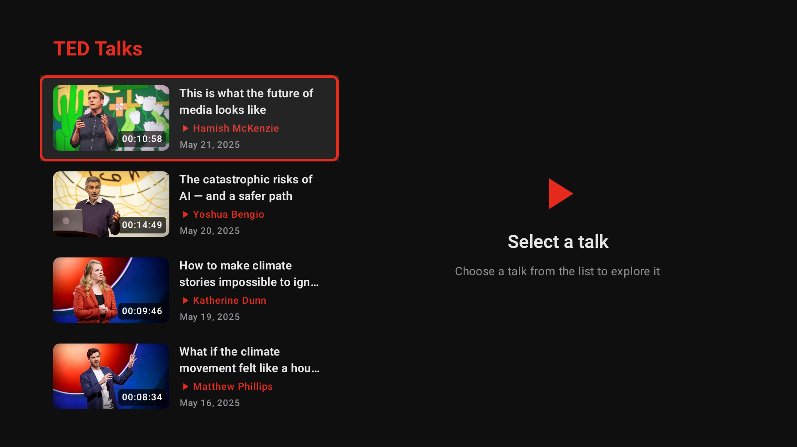
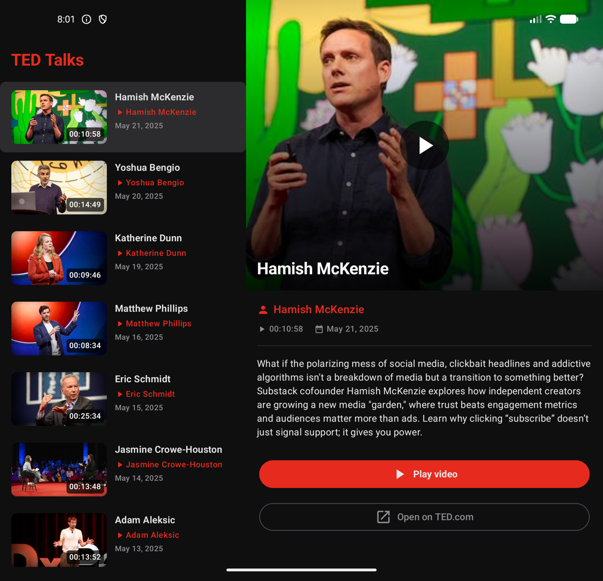

# TED Talks Adaptive Showcase

[](https://github.com/jpcottin/tedtalksapp/actions/workflows/android.yml)

<details>
<summary><b>CI details</b> — build/lint/screenshot jobs + emulator matrix, API 32 → 37.2, plus Android CLI and Emulator Preview legs</summary>

Besides lint, unit tests, Compose screenshot validation, and a debug build, instrumented tests run on GitHub-hosted emulators:

| Legs | Image | Emulator channel | GPU | Gating |
|---|---|---|---|---|
| API 32, 33, 34, 35, 36 | `google_apis` x86_64 | stable | auto | ✅ blocking |
| API 37.0 | `google_apis_ps16k` (16 KB page size) | stable | lavapipe | non-blocking |
| API 37.0 | `google_apis_ps16k` | canary (`--channel=3`) | lavapipe, auto | non-blocking |
| API 37.1 | `google_apis_ps16k` | canary | lavapipe, auto | non-blocking |
| API 37.2 | `google_apis_ps16k` | canary | lavapipe, auto | non-blocking |
| Android CLI experiment | `google_apis_ps16k` 37.0, 37.2 | canary | emulator default | non-blocking |
| Emulator Preview (`emulators;latest`) | `google_apis_ps16k` 37.0, 37.1, 37.2 | preview package | auto | non-blocking |
| Emulator Preview multi-run (snapshot cycles) | `google_apis_ps16k` 37.0 | preview package | auto | non-blocking |
| Android CLI multi-run (snapshot cycles) | `google_apis_ps16k` 37.0 | canary | emulator default | non-blocking |

The Android CLI leg drives the whole flow with the [`android` CLI](https://d.android.com/tools/agents/android-cli) (`android sdk install --canary`, `android emulator create/start/stop`) instead of `sdkmanager`/`avdmanager` and the emulator-runner action.

Two of the non-blocking jobs run a **snapshot multi-run experiment**: the emulator is booted four
times against the same AVD with quickboot snapshots enabled, the app is launched only on the first
cycle, and every later cycle checks whether the snapshot brought it back by itself — still running,
and still rendering. The app is deliberately never relaunched after a restore, since that is the
thing being measured. One job drives the Emulator Preview package, the other the canary emulator
through the `android` CLI, so the same experiment can be compared across both.

Because this app's UI is static between interactions, rendering is judged with `android layout`
rather than by diffing two screenshots — a screenshot diff would report a stall on every cycle. A
non-empty layout tree plus a focused window means the UI is present and enumerable. Screenshots are
still captured and uploaded for every cycle. The preview jobs share their setup through the
composite action in `.github/actions/preview-emulator`, and
`scripts/replay-preview-multirun.sh` replays the multi-run job locally in a few minutes instead of a
push cycle.

All emulator-runner legs use full diagnostics (`-verbose -show-kernel -debug-metrics -metrics-collection`) and a `cmdline-tools;latest` update so `avdmanager` writes a valid `target=android-37.x` (the runner's preinstalled version writes `android-0`, which the emulator clamps to API 3, disabling the Vulkan/GLDirectMem auto-enable the ps16k images need).

</details>

A high-fidelity Android demonstration app centered around the official [TED Talks RSS feed](https://feeds.feedburner.com/TedtalksHD). This project serves as a reference implementation for building deeply adaptive UIs that span the entire Android ecosystem—from compact mobile screens and foldables to large-screen spatial environments like Android XR and lean-back experiences on Google TV.

> **Note: two sources since November 2026.** TED's HD video feed froze on May 21, 2025 and, on November 1, 2026, every TED feed address (this one included) started relaying the *TED Talks Daily* podcast from Acast instead: about 2,850 episodes back to 2017, each an mp3 enclosure with its own cover art, the title written as `Talk title | Speaker`, and `itunes:author` set to the publisher ("TED") rather than the speaker. No TED feed carries video anymore, but the 148 HD talks still download from TED's CDN. So the app ships the HD feed as it last stood (`app/src/main/assets/ted_talks_hd.xml`) and lists those **videos by default**; the **Audio** chip in the app bar adds the live podcast's episodes, newest first, each marked with a headphones badge. The choice is remembered. Should a file stop being served one day, the talk's page says so in words (see *Media playback*).

## 🚀 Key Objectives

- **Two talk sources:** the bundled HD video feed and the live audio feed, parsed by the same RSS parser and merged by date behind one toggle (see the feed note above).
- **Adaptive Layout Excellence:** A single codebase supports radically different form factors using Jetpack Compose's latest adaptive APIs.
- **Cross-Platform Consistency:** High-quality experience on Phone, Tablet, Foldable, TV, and XR.
- **Adaptive Navigation:** Uses **Navigation 3** with `ListDetailSceneStrategy` so the list/detail layout collapses to a single pane on phones and expands to side-by-side panes on foldables, tablets, and XR. Each pane is its own back-stack entry rather than a managed child of a scaffold.
- **Edge-to-edge UI:** The app draws under the system bars (Android 15+ default) and applies `WindowInsets.safeDrawing` everywhere a Scaffold doesn't already handle them.
- **Device traits, not form-factor labels:** Compose's `mediaQuery { }` API decides how the UI behaves from what the device can do: viewing distance drives overscan margins and target sizes, pointer precision drives keyboard/D-pad focus handling, and window posture drives a tabletop layout on foldables.
- **Styles API:** Focus, hover, press and selection states are declared with the Compose Styles API (`androidx.compose.foundation.style`) instead of being tracked by hand in each composable.
- **Cross-Device Support:**
    - **Mobile/Foldable:** Responsive layout that adapts to posture changes (e.g., table-top mode).
    - **Android TV:** Optimized D-pad navigation, focus management, and overscan-safe margins.
    - **Android XR:** Leverages adaptive primitives for spatial computing environments.
- **Media Playback:** High-performance playback using Media3 ExoPlayer, video or audio with its cover art, with seamless transitions to fullscreen, picture-in-picture when leaving the app mid-playback, per-talk resume positions, and audio focus handling.
- **Modern UI:** Built entirely with Material 3 and a custom dark theme.

## 🛠 Tech Stack

- **UI:** [Jetpack Compose](https://developer.android.com/compose) (Material 3)
- **Adaptive Layout:** [androidx.compose.material3.adaptive](https://developer.android.com/develop/ui/compose/layouts/adaptive) + `adaptive-navigation3`
- **Device traits:** [Compose MediaQuery](https://developer.android.com/develop/ui/compose/layouts/adaptive/mediaquery) (`androidx.compose.ui.mediaQuery`, experimental)
- **Interaction styling:** [Compose Styles](https://developer.android.com/develop/ui/compose/styles/fundamentals) (`androidx.compose.foundation.style`, experimental)
- **Navigation:** [Navigation 3](https://developer.android.com/jetpack/androidx/releases/navigation) with `ListDetailSceneStrategy`
- **Media:** [Media3 ExoPlayer](https://developer.android.com/guide/topics/media/exoplayer)
- **Image Loading:** [Coil 3](https://coil-kt.github.io/coil/) (Multiplatform)
- **Networking:** [OkHttp](https://square.github.io/okhttp/)
- **Architecture:** Clean Architecture with ViewModel + `StateFlow`, a `TedTalksRepository` interface, and constructor-injected dependencies for testability.

## 🧭 Architecture notes

### Navigation 3 list-detail

`Navigation.kt` is the composition root. It builds a `NavBackStack` containing two destinations:

- `TalksList` — annotated with `ListDetailSceneStrategy.listPane(detailPlaceholder = …)`. Always visible; provides a placeholder pane when no talk is selected.
- `TalkDetail(talkId)` — annotated with `ListDetailSceneStrategy.detailPane()`.

`ListDetailSceneStrategy` observes the back stack and the window's adaptive info to render the appropriate scene (single pane vs. side-by-side). The detail pane hides its back button when `maxHorizontalPartitions > 1` because the list pane is already visible.

### Device traits (MediaQuery)

`DeviceTraits.kt` wraps Compose's experimental `mediaQuery { }` API in a handful of named questions the UI asks instead of checking `uiMode` or screen size:

| Trait | Query | Used for |
|---|---|---|
| `isFarViewing()` | `viewingDistance == Far` | 48dp / 27dp overscan-safe padding around the whole UI; an 88dp play target on the hero. |
| `hasNoPointer()` | `pointerPrecision == None` | Focus is the only cursor, so the first list item and the video player take focus as soon as they appear (TV remote, keyboard-only desktop, XR without hand tracking). |
| `hasFinePointer()` | `pointerPrecision == Fine` | A mouse or trackpad is attached: the hero play target shrinks to 56dp. |
| `isTabletopPosture()` | `windowPosture == Tabletop` | A half-opened foldable with a horizontal hinge: the detail pane puts the video or hero image on the upper half and the scrolling text and controls on the lower half, so the fold never cuts through either. |

`isTelevision()` (leanback `uiMode`) is kept only for a platform fact that isn't an adaptive trait: leanback devices have no browser, so the "Open on TED.com" button is hidden there.

The API is gated behind `ComposeUiFlags.isMediaQueryIntegrationEnabled`. Compose reads the flag once per composition root, so `TedTalksApplication.onCreate` turns it on before any Activity composes. When the flag is off (Android Studio previews render without the Application class) each trait falls back to the `uiMode` heuristic the app used before, so previews still render. `LogDeviceTraits()` prints the resolved values to logcat under the `DeviceTraits` tag, which is handy when reading the CI emulator logs.

### Styles

`theme/ComponentStyles.kt` declares the app's interaction styling with the Compose Styles API:

- `TedTalksStyles.focusRing` — a 3dp border that is transparent at rest, animates to the brand red when focused, and shows at half opacity on mouse hover.
- `TedTalksStyles.talkListItem` — shape, content padding, and hover / press / selected backgrounds for a row of the talk list.

The list row applies both with `Modifier.styleable(styleState, focusRing, talkListItem)`, where the `StyleState` comes from `rememberUpdatedStyleState(interactionSource) { it.isSelected = isSelected }` and the same `InteractionSource` is handed to `clickable`. Material buttons don't take a `Style` parameter, so `Modifier.focusRing(interactionSource, shape)` in `FocusSupport.kt` attaches the ring through `Modifier.styleable` using the `InteractionSource` passed to the button. Both APIs need `compileSdk 37` and Compose 1.12, and are opted in project-wide in `app/build.gradle.kts`.

### Edge-to-edge

- `MainActivity.onCreate` calls `enableEdgeToEdge(SystemBarStyle.dark(...), SystemBarStyle.dark(...))` because the app forces a dark Compose theme regardless of the system setting.
- `TalkListPane` uses a Material 3 `Scaffold` with `contentWindowInsets = WindowInsets.safeDrawing`, forwards `innerPadding` to the `LazyVerticalGrid.contentPadding`, and consumes it with `consumeWindowInsets(innerPadding)` so nothing below pads twice.
- `TalkDetailPane`'s hero is intentionally edge-to-edge; the M3 `TopAppBar` overlay applies its own status-bar inset and the text body underneath applies `WindowInsets.safeDrawing.only(Horizontal + Bottom)`.
- The fullscreen video `Dialog` uses `decorFitsSystemWindows = false` and hides the system bars while playing.

### Talk sources

- **Bundled videos** — `DefaultTedTalksRepository` takes a `bundledFeed` opener (the asset, in production) and parses it once; without the Audio toggle it never touches the network. With the toggle it fetches the live feed and returns both lists sorted by `publishedMillis`, newest first; a live fetch that fails is a failure, so the view model keeps the list it has and reports through the refresh snackbar rather than silently dropping the audio talks. Without a bundled feed (tests), the live feed is all there is, toggle or not.
- **The choice** — `TalkSourceSettings` (`SharedPreferences` in the app, in-memory in tests) seeds `TedTalksViewModel.includeAudio`; `setIncludeAudio` saves it, drops any fetch in flight and reloads behind the list. `TalkListPane` shows the `FilterChip` only when given an `onIncludeAudioChange`, so previews and fixed lists have no chip. On a D-pad device the chip's `focusProperties { down }` points at the first row: the default focus search from the app bar into the grid does not find the rows on a TV.
- **Audio rows** — `TalkItem.isAudio` puts a headphones icon in the duration pill of the list row (content description "Audio").

### Media playback

- **Playback errors** — `VideoPlayerView` reports `Player.Listener.onPlayerError` to `TalkDetailPane`, which drops the player and shows the reason under the description in `PlaybackFailure.describe` words: a file the server no longer serves ("TED no longer serves this talk's video (its server answered HTTP 404)…"), no network ("could not be reached"), a stream the device cannot decode, else the Media3 error code name. The body's button becomes *Try again*; the view model's `getExoPlayer` prepares an idle player again on the next tap.
- **Audio talks** — a talk the feed carries as an mp3 goes through the same `ExoPlayer` and `PlayerView` as a video. `VideoPlayerView` takes the talk's cover art as the view's default artwork (loaded with Coil, `ARTWORK_DISPLAY_MODE_FILL`), which `PlayerView` shows by itself whenever the media has no video track, inline, fullscreen and in the picture-in-picture window alike; the screen is not kept awake for it. The body's button reads *Listen* instead of *Play video*.
- **Picture-in-picture** — `PipSupport.kt` keeps the activity's PiP params in sync with playback: on Android 12+ it uses `setAutoEnterEnabled` so leaving the app during playback enters PiP with a smooth animation (source rect hint fed from the player's on-screen bounds); on Android 8–11 it falls back to entering on the user-leave hint. While in PiP, `TalkDetailPane` renders only the video full-bleed with controls hidden, and the usual pause-on-`ON_PAUSE` is skipped when the pause is caused by entering PiP. The adaptive scaffold collapses to a single pane automatically inside the tiny PiP window.
- **Resume positions** — `TedTalksViewModel` keeps a per-URL playback position map; switching back to a talk seeks to where it left off (`setMediaItem` → `seekTo` → `prepare`). Talks that played to the end restart from the beginning.
- **One player view across layouts** — the scrolling page, the tabletop split and the picture-in-picture window each place the video in a different part of the tree. `TalkDetailPane` wraps `VideoPlayerView` in `movableContentOf`, so a layout switch moves the existing `PlayerView` node instead of inflating a new one: the player keeps its surface (no black frame mid-playback) and the view keeps its fullscreen and focus state.
- **Audio focus** — the player is built with `setAudioAttributes(..., handleAudioFocus = true)` and `setHandleAudioBecomingNoisy(true)`, so it ducks/pauses correctly for other media apps and pauses when headphones are unplugged. The `ExoPlayer` factory is constructor-injected for unit testing.

### Adaptive list

`TalkListPane` uses `LazyVerticalGrid(columns = GridCells.Adaptive(360.dp))` so it stays single-column on phones (and on the narrow list pane of a two-pane layout) and expands to multiple columns when given more horizontal space. The app bar uses `TopAppBarDefaults.enterAlwaysScrollBehavior()`: it slides away as the grid scrolls down and returns as soon as the user scrolls up, giving the grid the full height on small windows.

### XR / TV specifics

The XR + TV workarounds remain in this branch:

- **Surface rendering (black video area)** — `SurfaceView` uses hardware hole-punching that conflicts with the XR spatial compositor, producing a black rectangle. A custom `view_player.xml` layout (`app:surface_type="texture_view"`) composites the video correctly into the XR panel.
- **SSL trust anchor (Sectigo Root R46)** — the XR emulator ships without Sectigo Public Server Authentication Root R46, the root CA that signs TED's video CDN (`download.ted.com`). `network_security_config.xml` bundles this certificate scoped to `ted.com` and `feedburner.com`; SSL validation is fully preserved for all other domains.
- **Overscan margins** — `Navigation.kt` adds 48dp / 27dp safe-area padding when the MediaQuery viewing distance is `Far` (TV).

### D-pad navigation & focus

- **Visible focus** — Material's default focus indication (a faint state layer) is invisible on image-heavy lean-back layouts, so `TedTalksStyles.focusRing` (a Compose `Style`) draws a 3dp brand-red border on the focused list item, hero play overlay, and detail buttons; see the Styles section above.
- **Player key dispatch** — per the Media3 TV recipe, the inline and fullscreen `PlayerView` wrappers forward Compose key events with `onKeyEvent { playerView.dispatchKeyEvent(it.nativeKeyEvent) }`, and when no pointing device is present (`hasNoPointer()`) the player requests focus when playback starts. DPAD-CENTER shows the controller and toggles play/pause; BACK falls through once the controller is hidden so navigation still pops.
- **Focus restoration** — the talk grid uses `Modifier.focusRestorer(...)`, so backing out of a detail pane returns focus to the item that opened it rather than the top of the list.
- **Two-pane back fix** — in a two-pane scene `ListDetailSceneStrategy` reports no previous entries, which disables `NavDisplay`'s built-in back handling; BACK would close the activity instead of dismissing the detail pane (this affects TV, tablets, foldables, and XR). `MainNavigation` adds a fallback `BackHandler` that pops the back stack; in single-pane scenes `NavDisplay`'s own handler still wins, keeping the predictive-back animation.
- **Into the grid from the app bar** — on a TV, DOWN from the Audio chip found no row by itself (focus stayed on the chip for good), so the chip's `focusProperties { down }` names the first row; UP from the first row reaches the chip as usual.
- **No pull-to-refresh without a pointer** — the grid sits in a `PullToRefreshBox` only when the device has a pointer. A TV has no pull gesture, and the box took the first row's focus request (a scroll to bring it into view) for a pull, leaving its arrow drawn over the row; a reload there comes from the chip or the retry button.
- **No browser on TV** — the "Open on TED.com" button is hidden in leanback mode (web links are a dead end on TV) and guarded with `ActivityNotFoundException` elsewhere.

## 🧪 Testing

The repository is wired for constructor injection, so tests can pass a fake without touching the network.

- **`TedTalksRepository`** is an interface; `DefaultTedTalksRepository` is the production implementation.
- **`FakeTedTalksRepository`** lives in `app/src/test/.../data/` and lets tests pin any `Result<List<TalkItem>>`.
- **`DefaultTedTalksRepository`** is tested against an in-process [`MockWebServer`](https://square.github.io/okhttp/features/mockwebserver/) so HTTP error codes, malformed XML, empty feeds, and the request URL/method are all covered without hitting the network.

| Type | Source set | Command | What it covers |
|------|-----------|---------|----------------|
| Unit tests | `src/test/` | `./gradlew :app:testDebugUnitTest` | `RssFeedParser` parsing edge cases, `DefaultTedTalksRepository` HTTP behavior via MockWebServer, and `TedTalksViewModel` state machine (loading / success / error / retry / selection) and playback-position bookkeeping (resume / restart-after-finish) and player lifecycle (one player per view model, paused on deselect, released when the owner is cleared) against a mocked `ExoPlayer`; feed image precedence and media selection (an mp4 from `media:content` or an `enclosure` ahead of an mp3, other types ignored), the speaker read from the title when the author is the channel's own, the publication instant; the repository's two sources (bundled videos alone by default, merged with the live feed newest first, parsed once, a live failure reported, live only without a bundle); the view model's Audio choice (seeded from the settings, saved, a fetch in flight dropped for the new one); the playback failure messages; the picture-in-picture aspect clamp. |
| Compose UI tests | `src/androidTest/` | `./gradlew :app:connectedDebugAndroidTest` | `TalkListPane`, `TalkDetailPane`, and the full `MainNavigation` graph (including a back-from-detail regression guard for the two-pane back fix, a check that the inline `PlayerView` survives a posture switch to tabletop, a tap on the hero play button with the back button overlaid on it, an audio talk offering Play and Listen, a talk whose media cannot be reached explaining itself and offering Try again, the Audio chip asking for the other choice and absent without one, the audio badge on a row, and no pull-to-refresh on a D-pad device) against a small in-test `TedTalksRepository` fake that serves a fixed talk list. Pane assertions scroll to off-screen nodes so they pass on TV/wide viewports too. |
| Screenshot tests | `src/screenshotTest/` | `./gradlew :app:updateDebugScreenshotTest` (record) / `./gradlew :app:validateDebugScreenshotTest` (verify) | Curated `@PreviewTest` previews: `TalkListPane` loading and error states plus its success state on phone, foldable and tablet; `TalkDetailPane` on phone (light and dark), on tablet, and in the tabletop posture (produced by overriding `LocalUiMediaScope` the way the MediaQuery docs recommend for previews); and `EmptyDetailPlaceholder`. Uses the experimental [Compose Preview Screenshot Testing tool](https://developer.android.com/studio/preview/compose-screenshot-testing). |

Compose `@Preview`s in `src/main/` (e.g. `TalkListPanePreview`) remain for design-time use in Android Studio and are tagged with a `FormFactorPreviews` multi-preview annotation.

## 📦 Release build

The `release` build type enables R8 (`isMinifyEnabled = true`) and resource shrinking (`isShrinkResources = true`), taking the APK from ~23.7 MB (debug) to **~2.4 MB**. `proguard-rules.pro` is intentionally empty: every dependency ships its own consumer keep rules, including `kotlinx-serialization`, whose bundled rules keep the generated serializers for the `@Serializable` `NavKey`s (`TalksList`/`TalkDetail`) used in back-stack persistence. This was verified with a minified build that parses the live feed, navigates, and restores the back stack across process death; see [`R8_Configuration_Analysis.md`](R8_Configuration_Analysis.md). `kxml2` is `testImplementation`-only, so XML parsing needs no runtime keep rule.

### Signing

The `release` build type is signed with a real release key, configured **outside source control**:

- **Local:** copy [`keystore.properties.template`](keystore.properties.template) to `keystore.properties` (gitignored) and fill in `storeFile` / `storePassword` / `keyAlias` / `keyPassword`. `storeFile` is resolved relative to the repo root.
- **CI:** provide the same values as environment variables — `RELEASE_STORE_FILE`, `RELEASE_STORE_PASSWORD`, `RELEASE_KEY_ALIAS`, `RELEASE_KEY_PASSWORD` (each property falls back to its env var).
- **No key configured:** the release build falls back to **debug signing** (with a build warning), so CI and contributor builds work without the signing secrets.

`keystore.properties`, `*.jks`, and `*.keystore` are gitignored — **never commit the keystore or its credentials.** Generate an upload key with:

```bash
keytool -genkeypair -v -keystore keystore/release.jks -alias tedtalks \
  -keyalg RSA -keysize 2048 -validity 10000
```

### Baseline profiles

The `:baselineprofile` module (`com.android.test` + `androidx.baselineprofile`) generates a [Baseline Profile](https://developer.android.com/topic/performance/baselineprofiles/overview) so ART can AOT-compile the startup and core-navigation hot paths instead of JIT-ing them on first run.

- **Generator** — `BaselineProfileGenerator` drives a cold start plus a browse → open-detail → back journey via UI Automator. The app depends on `androidx.profileinstaller`, which bundles the compiled profile (`assets/dexopt/baseline.prof`) into the release APK and installs it on first launch.
- **Regenerate** — `./gradlew :app:generateReleaseBaselineProfile` (needs a connected device/emulator). Output is committed at `app/src/release/generated/baselineProfiles/{baseline,startup}-prof.txt` so releases ship the profile without regenerating.
- **Measure** — `StartupBenchmark` compares cold-start time with `CompilationMode.None()` vs the baseline profile. Run it on a **physical device** for representative numbers (emulator timings are not meaningful): `./gradlew :baselineprofile:connectedBenchmarkReleaseAndroidTest`.

> Baseline/benchmark tooling is on `androidx.benchmark` / `androidx.baselineprofile` `1.5.0-alpha06`, the line that supports AGP 9.

### CI

Pushes to `main` and PRs targeting it run [`.github/workflows/android.yml`](.github/workflows/android.yml). The build job and the API 32 to 36 legs of the instrumented matrix gate merges; the API 37.x legs and the experiment jobs explore newer emulator tooling and are marked `continue-on-error`, so a preview package that moves underneath us reports its findings without blocking a PR.

| Job | What it does | Gates | Artifacts |
|-----|-------------|-------|-----------|
| **build** | lint → unit tests → screenshot validation → debug build | yes | `screenshot-test-report` (HTML diff report, on failure) |
| **Instrumented Tests** | `connectedDebugAndroidTest` (the Compose UI tests) on x86\_64 `google_apis` emulators at API 32, 33, 34, 35 and 36 with `-gpu auto` | yes | `instrumented-test-report-api*` |
| **Instrumented Tests, API 37.x legs** | The same matrix job's non-blocking legs: the same tests on the API 37.0, 37.1 and 37.2 `google_apis_ps16k` images (16 KB page size): 37.0 from the stable channel on lavapipe, and every level from the canary channel on lavapipe and auto | no | `instrumented-test-report-api37.*-<suffix>` |
| **Android CLI experiment** | The whole emulator flow through the [`android` CLI](https://d.android.com/tools/agents/android-cli) (`android sdk install --canary`, `android emulator create/start/stop`) on the canary emulator, API 37.0 and 37.2 | no | `instrumented-test-report-android-cli-experiment-*` (on failure) |
| **Emulator Preview experiment** | The `emulators;latest` preview package launched by its own binary, API 37.0, 37.1 and 37.2 | no | `instrumented-test-report-emulator-preview-*` (on failure) |
| **Emulator Preview multi-run** | Four boot cycles against the same AVD with quickboot snapshots enabled: the app is launched in the first cycle only, and every later cycle checks the snapshot brought it back by itself, still running and still rendering | no | `preview-multirun-screenshots`, `preview-multirun-emulator-logs` |
| **Android CLI multi-run** | The same four-cycle snapshot experiment driven by the `android` CLI against the canary emulator, as a comparison | no | `cli-multirun-screenshots`, `cli-multirun-logs` |

Every emulator-runner leg boots with full diagnostics (`-verbose -show-kernel -debug-metrics -metrics-collection`) and `-delay-adb`, and refreshes `cmdline-tools` first so `avdmanager` writes a valid `target=android-37.x` for the minor-versioned images.

## 📱 Screenshots

| Phone | Foldable (Inner) | Android XR | Google TV |
|-------|------------------|------------|-----------|
|  |  |  |  |

| Foldable, tabletop posture (`mediaQuery { windowPosture == Tabletop }`) |
|---|
|  |

## 🛠 Getting Started

### Prerequisites
- Android Studio Otter 3+ (for full IDE integration with the Compose Preview Screenshot Testing tool — optional, the underlying Gradle tasks work without it).
- Android SDK 37 (`compileSdk` 37 for the latest adaptive and XR APIs; `targetSdk` 36).
- JDK 17.

### Build & Run
```bash
./gradlew installDebug
```

### Run the test suites
```bash
./gradlew :app:testDebugUnitTest                # unit tests (parser, repository, viewmodel)
./gradlew :app:connectedDebugAndroidTest        # Compose UI tests (requires a device/emulator)
./gradlew :app:updateDebugScreenshotTest        # (re)record reference screenshots
./gradlew :app:validateDebugScreenshotTest      # verify screenshots haven't regressed
./gradlew :app:lintDebug                        # lint, also part of the CI build job
```

## 📄 License

This project is licensed under the MIT License - see the [LICENSE](LICENSE) file for details.

TED Talks and the TED logo are trademarks of TED Conferences, LLC. This application is an unofficial showcase and is not affiliated with or endorsed by TED Conferences, LLC.
